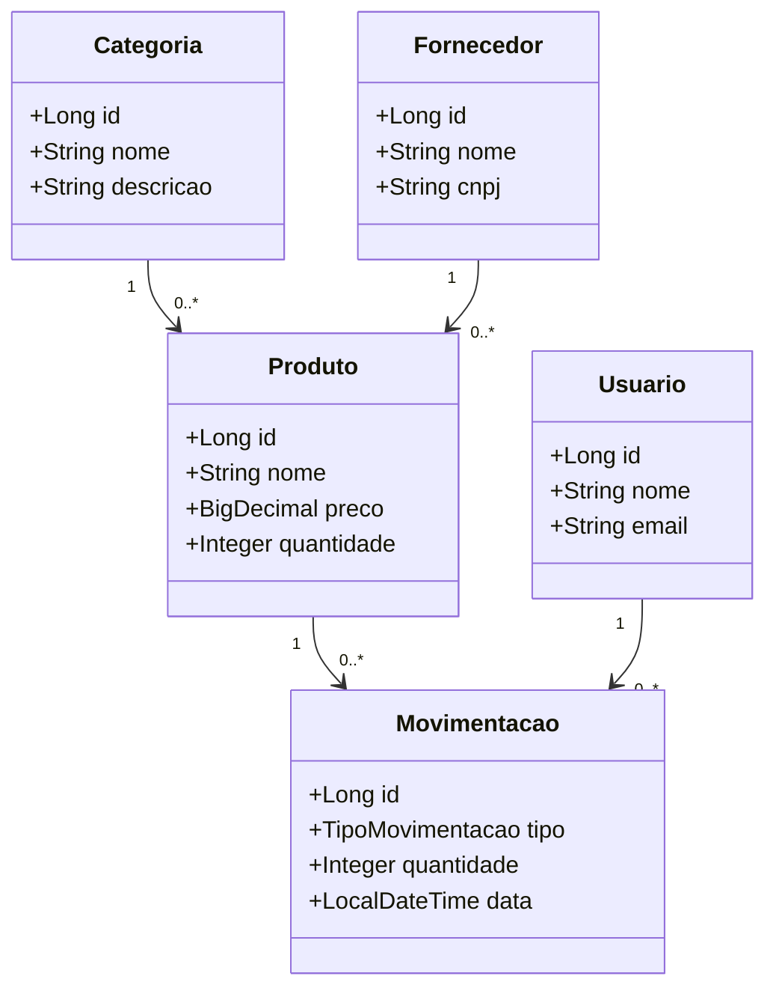
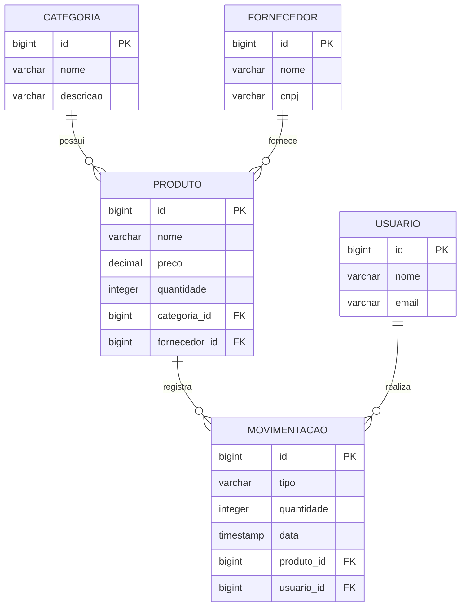

# Modelagem de dados

## Entidades

- **Categoria**: identificador, nome e descrição.
- **Fornecedor**: identificador, nome e CNPJ.
- **Produto**: identificador, nome, preço, quantidade, categoria e fornecedor.
- **Usuario**: identificador, nome e e-mail.
- **Movimentacao**: identificador, tipo (ENTRADA/SAIDA), quantidade, data, produto e usuário.

## Diagrama de classes (simplificado)

## Modelo relacional (MER lógico)

As tabelas são geradas automaticamente pelo Hibernate com `spring.jpa.hibernate.ddl-auto=update`. Os nomes de colunas podem variar conforme o dialeto e a estratégia de nomenclatura do JPA.
